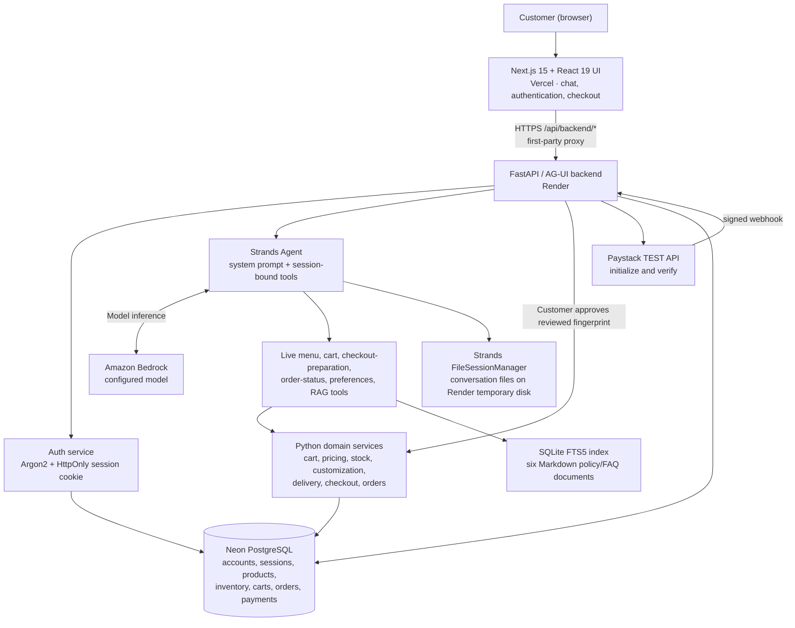

# Naija Bites — AI Vendor Sales and Order Assistant

**Project 2: Vendor Sales and Order AI Agent** · Nigerian food and small-chops business · **Assignment demonstration only**

Naija Bites is a conversational sales assistant for a fictional Nigerian food vendor. Customers can ask about meals and ingredients, discover available items, customize portions, manage a cart, check delivery coverage, request eligible discounts, review an accurate order total, approve checkout, and follow a **Paystack TEST** payment flow. The assistant uses an LLM for natural conversation, but business-critical decisions are implemented in Python services and backed by a database.

> **Demo safety:** No real food is sold or delivered. Use fictional customer details, fictional delivery addresses, and Paystack test-mode credentials. Never enter payment-card details in chat. The public demo is not a production commerce service.

**Assignment brief:** [Use_case.md](Use_case.md) · **Architecture and sequence diagrams:** [docs/SYSTEM_ARCHITECTURE.md](docs/SYSTEM_ARCHITECTURE.md) · **Deployment guide:** [DEPLOY_DEMO.md](DEPLOY_DEMO.md) · **PostgreSQL guide:** [POSTGRES_SETUP.md](POSTGRES_SETUP.md)

## 1. Problem and objectives

A small online vendor may spend much of the day answering repeated product questions, checking stock, quoting delivery fees, bargaining, recording orders, and resolving complaints. Manual chat-based ordering can introduce errors in quantities, pricing, addresses, and payment status.

The assignment asks for a **WhatsApp-style chat experience**—not a WhatsApp integration—tested on Fleet, with **20–30 products**, controlled negotiation, order confirmation, a mock payment link, status checks, a policy RAG knowledge base, and escalation. Naija Bites selects the **food and small chops** category and implements a browser-based conversational experience.

The engineering objective is **reliable AI-assisted commerce**: the model handles conversation and tool selection; trusted application code handles validation, totals, authorization, inventory changes, order placement, and payment verification.

## 2. System architecture



**The trust boundary:** An AI tool named `create_order` **only prepares checkout**; it does not insert an order. The authenticated customer must approve the server-calculated summary via `POST /checkout/confirm`. The backend checks the summary fingerprint, recalculates price/stock, inserts the order, and decrements inventory in a transaction. A successful chat response is **never** proof of an order or payment.

For detailed component responsibilities, order/payment sequence diagrams, and data relationships, see [docs/SYSTEM_ARCHITECTURE.md](docs/SYSTEM_ARCHITECTURE.md).

## 3. Technology stack

| Layer | Technology | Role |
|---|---|---|
| Frontend | Next.js 15, React 19, TypeScript, Lucide | Authenticated chat UI, streaming replies, review and payment actions |
| Web API | FastAPI, Pydantic, Uvicorn | HTTP endpoints, session authorization, checkout and payment endpoints |
| Agent | Strands Agents SDK, `ag-ui-strands`, AG-UI protocol | Tool-calling agent and streamed UI events |
| LLM | AWS Bedrock | Hosted model inference; model ID configurable |
| Operational database | PostgreSQL (Neon when deployed); SQLite locally | Customer records, hashed sessions, catalogue, stock, carts, orders, payments |
| RAG | Markdown + SQLite FTS5 | Keyword retrieval of policies and FAQs; **not** an embeddings/vector database |
| Model conversation memory | Strands `FileSessionManager` | File-backed model/tool history; ephemeral on free Render disk |
| Payment | Paystack **test** mode | Test checkout URL, server verification, signed webhook |
| Hosting | Vercel + Render | Frontend and backend |
| Testing | Python `unittest`, standalone test scripts | Unit, integration, and manual scenario checks |

## 4. Functional scope and assignment mapping

The assignment's tool list names eight tools despite describing them as nine in its introduction. The repository contains the eight named tool modules plus additional cart, customization, memory, and RAG tools.

| Assignment requirement | Code location / mechanism | Current implementation assessment |
|---|---|---|
| 20–30 fictional products | `database/seed.py` | **30 seeded products**, with prices, descriptions and starting stock |
| Product search and questions | `agent.py` `browse_menu`, `search_menu`; `tools/catalogue.py` | Live catalogue access; standalone `search_catalogue` exists but is **not registered by `make_agent`** |
| Stock/variants | `database/repository.py`, `services/cart.py`, `services/order_service.py`; `tools/inventory.py` | Stock checked through cart and checkout services; standalone `check_stock` exists but is **not registered directly** |
| Delivery fee and time | `agent.py` `list_delivery_areas`, `database/seed.py`, order service; `tools/delivery.py` | Database-backed zone fees/estimates; standalone `get_delivery_fee` exists but is **not registered directly** |
| Negotiate within limits | `config.py`, `services/discount_service.py`, order service | Deterministic tier rules; standalone `apply_discount` exists but is **not registered directly** |
| Build and modify order | `tools/cart.py`, `services/cart.py`, `tools/orders.py` | Session-scoped cart, modifications, checkout preparation |
| Explicit order confirmation | `services/checkout.py`, `services/order_service.py`, `POST /checkout/confirm` | Application-controlled approval, fingerprint and stock recheck |
| Payment link | `services/paystack_service.py`, `POST /payments/initialize` | Paystack **TEST** hosted checkout; separate `tools/payment.py` mock-link tool exists but is **not registered** |
| Payment/order status | `tools/orders.py` `get_order_status`, payment verification endpoints | Owner-scoped order lookup; payment status updated only after provider verification |
| Returns, exchanges, policies | `rag/knowledge/`, `rag/tool.py` | Six Markdown documents retrieved through FTS5 |
| 20 common FAQs | `rag/knowledge/06_tone_guide_and_faq.md` | **20 numbered FAQs** |
| Escalation | `tools/notifications.py` | Simulated notification file; **not registered in active agent**, no actual owner delivery |
| Optional owner mode / voice | — | **Not implemented**; optional in brief |

**Important distinction:** “Implemented in the repository” does not always mean “callable by the deployed agent.” The active registration list is in `agent.py`. The README does not claim that unregistered standalone tools are reachable from chat.

## 5. Sample business data

`database/seed.py` defines **30 products** across main meals, soups, swallows, proteins/sides and snacks/small chops. Examples include Party Jollof Rice, Fried Rice, Egusi Soup, Efo Riro, Pounded Yam, Amala, Fried Chicken, Fried Plantain, Small Chops Pack and Puff-Puff. Prices are in **NGN** and the actual price/availability should always be read from the database rather than assumed from a document or model output.

The same seed file defines **10 Lagos delivery zones**. These are fictional example rates, not real-world delivery quotes:

| Area | Seed fee (NGN) | Estimated hours |
|---|---:|---|
| Ikeja | 1,500 | 1–2 |
| Maryland | 1,800 | 1–3 |
| Ogba | 1,800 | 1–3 |
| Yaba | 2,500 | 2–4 |
| Surulere | 2,800 | 2–4 |
| Gbagada | 2,500 | 2–4 |
| Magodo | 2,500 | 2–4 |
| Victoria Island | 4,000 | 3–5 |
| Lekki Phase 1 | 4,500 | 3–5 |
| Ajah | 5,500 | 4–6 |

**Pricing rules** (`config.py`): discounts begin at a ₦15,000 subtotal. Configured bulk tiers are **3% at ₦15,000**, **5% at ₦30,000**, and **10% at ₦50,000**; 10% is the maximum. Discount stacking and arbitrary agent-created discounts are disabled. The order service calculates eligible discounts, rather than allowing the LLM to edit totals.

**Customizations:** `database/seed_customizations.py` defines removable meal components and approved extras. `services/customization_service.py` validates choices and prices against live data. The system does not promise unsupported substitutions or allergy guarantees.

## 6. How a customer interaction works

1. **Sign in:** A customer registers/logs in. FastAPI verifies an Argon2 password hash and issues an HttpOnly session cookie; authenticated identity is resolved on the server.
2. **Ask:** The browser sends an AG-UI chat request to `POST /agent`; FastAPI assigns a trusted customer session instead of trusting a client-supplied session ID.
3. **Reason and retrieve:** The Strands agent calls registered menu/cart/order/RAG tools as needed. Bedrock generates the conversational answer.
4. **Build cart:** Tool calls update the customer's database-backed cart. Product availability, supported customizations and quantities are validated.
5. **Prepare checkout:** The agent collects a delivery name, contact phone, address and supported area, then calls the session-bound `create_order` tool. Despite its name, this **prepares a review summary only**.
6. **Approve:** The UI obtains the pending server summary from `GET /checkout`. A separate customer approval invokes `POST /checkout/confirm` with the reviewed fingerprint. The server checks the current summary and stock again.
7. **Place order:** The application atomically saves the order/items, deducts stock, and clears the cart. New order status: `pending_payment`.
8. **Pay:** The authenticated customer requests a Paystack **test** checkout link. The backend initializes the transaction and stores its reference.
9. **Verify:** The backend checks the Paystack transaction server-to-server (or processes a signature-checked webhook) before marking payment `paid` and the order `confirmed`.
10. **Track:** The agent can retrieve an order's current status only when it belongs to the signed-in customer.

If a customer changes their cart, delivery details, or relevant stock changes after the summary is prepared, the old fingerprint is invalid; a fresh summary and approval are required.

## 7. RAG: policy-grounded answers

The six source documents are:

1. `01_products_ingredients_care.md` — product information and ingredient guidance.
2. `02_delivery_policy.md` — delivery terms and timing.
3. `03_returns_exchanges_refunds.md` — returns, exchanges and refunds.
4. `04_payment_order_policy.md` — payments, confirmation and unpaid orders.
5. `05_negotiation_bulk_pricing.md` — negotiation and bulk pricing.
6. `06_tone_guide_and_faq.md` — tone guide and 20 customer FAQs.

`python -m rag.ingest` splits Markdown into sections and builds `rag/knowledge_index.db`. `rag/retriever.py` uses **SQLite FTS5/BM25 keyword search** with limited query expansion and returns source-labelled snippets; `rag/tool.py` exposes it to Strands. There is **no vector embedding model, vector store or semantic reranker**. The assistant should mention the relevant policy source when useful, and live database facts override static policy examples. A proposed policy (such as automatic unpaid-order expiry) is not a working feature merely because it appears in a document.

## 8. Data model and persistence

The main operational tables are `products`, `inventory`, `customers`, `auth_sessions`, `delivery_zones`, `orders`, `order_items`, `payments` and `conversation_sessions`. Customization adds `ingredients`, `meal_ingredients`, `meal_addons` and `order_item_customizations`; customer preference storage adds additional tables.

**Hosted mode:** `DATABASE_URL` selects PostgreSQL. `database/postgres.py` adapts the project's SQLite-style queries for PostgreSQL; the database is hosted on Neon. Operational records persist across Render restarts. **Local development:** absent `DATABASE_URL`, SQLite is used.

**Remaining persistence gap:** Strands model/tool message history is stored by `FileSessionManager` under `NAIJA_BITES_DATA_DIR/sessions` (or local `memory/sessions`). On Render's temporary disk this history can be lost on restart. PostgreSQL does not automatically make those files durable. The RAG index is also a local SQLite file rebuilt during backend deployment.

See [docs/SYSTEM_ARCHITECTURE.md](docs/SYSTEM_ARCHITECTURE.md) for a data relationship diagram.

## 9. API surface

| Method | Route | Purpose |
|---|---|---|
| `GET` | `/ping` | Health check |
| `POST` | `/auth/register` | Register customer |
| `POST` | `/auth/login` | Log in and issue cookie |
| `GET` | `/auth/me` | Validate current customer session |
| `POST` | `/auth/logout` | Revoke session and clear cookie |
| `POST` | `/agent` | Stream AG-UI / Strands responses |
| `GET` | `/checkout` | Retrieve pending server-calculated summary |
| `POST` | `/checkout/confirm` | Explicitly approve and place reviewed order |
| `GET` | `/checkout/dev-customer` | Development customer helper (requires auth) |
| `GET` | `/memory/pending` | Pending preference request |
| `POST` | `/memory/decision` | Approve/reject remembered preference |
| `POST` | `/payments/initialize` | Create Paystack test checkout |
| `POST` | `/payments/verify` | Verify payment with Paystack |
| `POST` | `/payments/webhook` | Signed payment webhook |

The browser normally uses the **same-origin** `/api/backend/*` proxy configured by `frontend/next.config.ts`, which forwards to Render via the server-side `NEXT_BACKEND_URL`. Do not expose secrets as `NEXT_PUBLIC_*` variables.

## 10. Run locally (development)

Prerequisites: **Python 3.10+** (per RAG component), Node.js/npm, an AWS account with access to the configured Bedrock model, and a Paystack **test** account for payment-flow demonstrations. Local SQLite requires no external database.

```bash
git clone https://github.com/Maahi17yr/AI-sales-agent.git
cd AI-sales-agent
python -m venv .venv
```

Activate the virtual environment using the appropriate command for your OS, then:

```bash
python -m pip install -r requirements.txt
python -m database.seed
python -m database.seed_customizations
python -m rag.ingest
```

Configure a **local, uncommitted** `.env` at the project root:

```dotenv
NAIJA_BITES_ENV=development
AWS_REGION=us-east-1
BEDROCK_MODEL_ID=<model-available-to-your-AWS-account>
# Use your normal AWS credentials/profile or an appropriately scoped role.
# For Paystack test checkout only:
PAYSTACK_SECRET_KEY=sk_test_<your-test-secret>
PAYSTACK_CALLBACK_URL=http://127.0.0.1:3000/?payment_return=1
```

Start the backend:

```bash
python -m uvicorn agui_server:app --host 127.0.0.1 --port 8000
```

In another terminal:

```bash
cd frontend
npm ci
```

Copy `frontend/.env.local.example` to `frontend/.env.local`, keeping the local direct backend URL (`NEXT_PUBLIC_AGUI_URL=http://127.0.0.1:8000`), then run:

```bash
npm run dev
```

Open **http://127.0.0.1:3000**. Use a fictional identity and a unique test password of at least 12 characters. Alternatively, `python main.py` runs the local-only terminal interface, including the `/review` approval step.

**Important:** Do not enable `NAIJA_BITES_ENV=demo` locally without the required HTTPS origin, PostgreSQL, Paystack test key and Bedrock configuration. The hosted deployment performs additional startup checks.

## 11. Hosted demo configuration

- **Frontend:** Vercel, repository root directory `frontend`, production branch `main`. Configure server-only `NEXT_BACKEND_URL=https://naija-bites-demo-api.onrender.com`; set `NEXT_PUBLIC_DEMO_MODE=true`. Omit `NEXT_PUBLIC_AGUI_URL` for hosted builds.
- **Backend:** Render, using `render.yaml` (installs requirements, builds RAG index, starts Uvicorn).
- **Database:** Neon PostgreSQL via secret `DATABASE_URL` with TLS.
- **Secrets:** `BEDROCK_MODEL_ID`, `AWS_REGION`, AWS credentials/role, `PAYSTACK_SECRET_KEY=sk_test_...`, `PAYSTACK_CALLBACK_URL`, `NAIJA_BITES_FRONTEND_ORIGIN`.
- **Callback/webhook:** Paystack test checkout redirects to the configured frontend; the Paystack test webhook points to the backend's `/payments/webhook`.

**Deployment caution:** `DEPLOY_DEMO.md` predates the PostgreSQL migration and still describes ephemeral SQLite for hosted operations; `POSTGRES_SETUP.md` records the later persistence change. The actual current `main` code requires `DATABASE_URL` in demo mode. Use the code and updated architecture as the source of truth. Do not copy secret values into GitHub or chat.

## 12. Assignment demo script

Use these seven scenarios from `Use_case.md` as a presentation checklist. A successful demo should show both the **customer-facing reply** and the **trusted tool/service result**:

| Scenario | Example prompt / action | Evidence to show |
|---|---|---|
| 1. Product enquiry | “How much is Party Jollof Rice, and is it available?” | Database-backed menu result; availability checked |
| 2. Order placement | “I want two meals delivered to Lekki Phase 1.” | Cart, delivery fee, total, review card, explicit approval, pending-payment order |
| 3. Negotiation | “Abeg reduce the price small.” | Allowed tier discount or refusal; no arbitrary discount |
| 4. Tracking | “Where is order #123?” | Current order status for **own** order only |
| 5. Returns/exchanges | “What if my meal isn't as expected?” | RAG-backed policy answer and source |
| 6. Out of stock | Ask for an unavailable item or quantity | Refusal and verified available alternative |
| 7. Order modification | Change meal quantity or delivery area before approval | Updated cart/fee/summary and new confirmation |

For payment, complete **Paystack test mode only** and verify the saved payment/order state. Do not use a fabricated “paid” chat message as evidence of payment.

**Suggested Fleet evaluation:** run the local frontend/backend or terminal demo in the assignment environment, exercise all seven scenarios, and capture screenshots or logs. The repository contains tests, but the documentation review **did not execute the full test suite or prove all seven scenarios end-to-end**.

## 13. Testing and known limitations

Suggested automated checks (from project root, after installation and database setup):

```bash
python -m rag.test_retrieval
python -m unittest discover -s tests -p "test_*.py" -v
```

The `tests/` directory mixes true `unittest` suites with standalone scripts that print output, mutate local data, or prompt for interactive input. Review individual scripts before running them against a shared database. Examples of focused suites: `tests/test_auth.py`, `tests/test_auth_api.py`, `tests/test_postgres_sql.py`, `tests/test_session_authorization.py`, `rag/tests/test_rag.py`. No fresh test run was performed while preparing this README.

Known gaps / honest evaluation:

- **Escalation:** `notify_owner` records a simulated JSON notification but is not wired into `make_agent`; there is no real owner alert or owner dashboard.
- **Tool wiring:** Several named assignment tools exist as modules but are not in the active Strands tool list. Equivalent behavior is often available through session-bound tools or trusted services; do not claim the exact named tool was called.
- **Session history:** Strands file-backed conversation history is not durable across Render temporary-disk resets.
- **Policies vs code:** Some fictional policy examples, including unpaid-order expiry, are not automated backend actions.
- **Order lifecycle:** Status retrieval exists, but there is no documented delivery-provider integration or complete owner fulfilment workflow.
- **Optional features:** Voice messages and owner-mode demand forecasting are not implemented.
- **Deployment:** Vercel preview branches can have different environment variables from production. The olive UI redesign remains on a separate, unmerged branch and is **outside this documentation baseline**.
- **Readiness:** This is an educational demo, not a real-food ordering/payment system; security, backups, abuse controls and operational monitoring need further work before real use.

## 14. Repository guide

```text
AI-sales-agent/
├── Use_case.md                 # Original assignment specification
├── agent.py                    # Strands agent factory and registered tools
├── system_prompt.py            # Model instructions and safety boundaries
├── agui_server.py              # FastAPI / AG-UI / auth / checkout / payment routes
├── main.py                     # Local terminal demo and explicit review
├── config.py                   # Business, discount, delivery and order settings
├── database/
│   ├── models.py               # SQLite or PostgreSQL connection and schema
│   ├── postgres.py             # PostgreSQL compatibility adapter
│   ├── repository.py           # Database queries and ownership checks
│   ├── seed.py                 # 30 products and 10 delivery zones
│   └── seed_customizations.py  # Approved ingredient changes and extras
├── services/
│   ├── auth_service.py         # Argon2, hashed login sessions
│   ├── cart.py                 # Cart validation and mutations
│   ├── customization_service.py
│   ├── discount_service.py
│   ├── checkout.py             # Prepared summary and confirmation
│   ├── order_service.py        # Atomic order/stock transaction
│   └── paystack_service.py     # Paystack TEST API verification
├── tools/                      # Strands tool wrappers and session-bound tools
├── rag/
│   ├── knowledge/              # Six fictional policy/FAQ Markdown files
│   ├── ingest.py               # SQLite FTS5 index builder
│   └── retriever.py            # Source-labelled keyword search
├── memory/                     # Strands session files and preference tools
├── observability/              # Optional tracing / tool monitoring utilities
├── frontend/
│   ├── app/page.tsx            # Chat, checkout, payment UI
│   ├── app/auth-provider.tsx   # Login/registration and auth state
│   └── next.config.ts          # First-party backend proxy
├── tests/                      # Unit, integration and standalone checks
├── render.yaml                 # Render deployment
└── docs/SYSTEM_ARCHITECTURE.md # Diagrams and technical walkthrough
```

## 15. Conclusion

Naija Bites demonstrates an **AI-assisted sales workflow** for a Nigerian food vendor. Its most important design principle is that **natural-language intelligence is not transaction authority**: the model helps a customer decide, while Python services, verified sessions, database constraints, explicit customer approval, and Paystack server verification protect business state. The project satisfies much of the assignment's functional design and provides a concrete foundation for demonstrating the seven scenarios, with the documented gaps remaining visible for honest assessment.

---
**Source of scope:** `Use_case.md` and the implementation on `main` at commit `db7f62f`. Documentation written without changing the application runtime.
