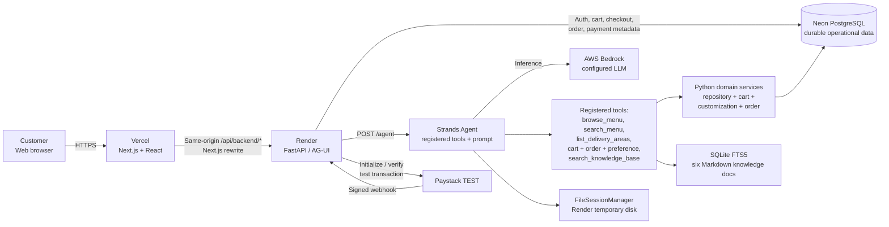
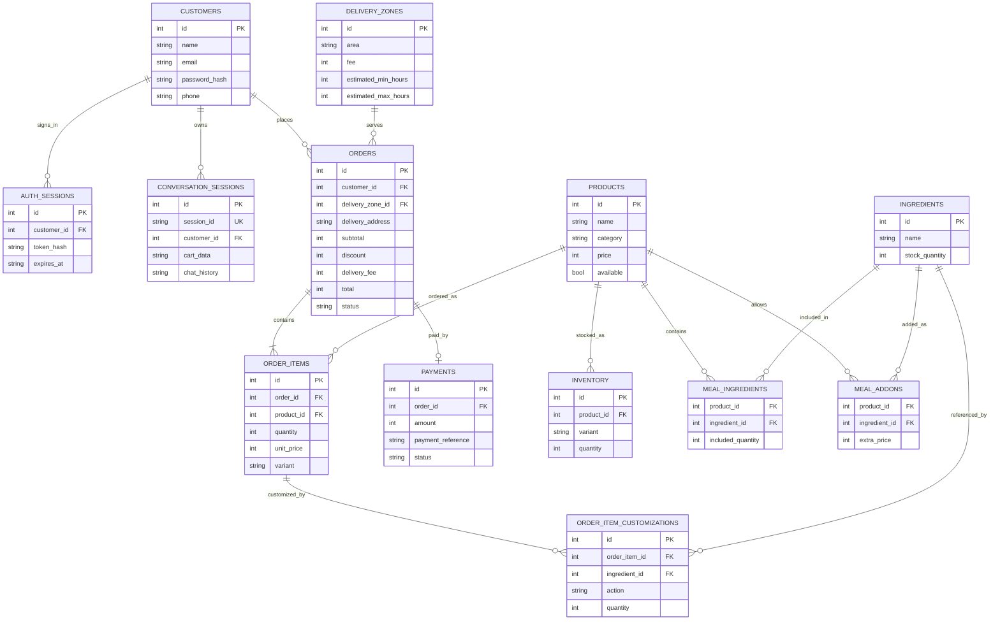
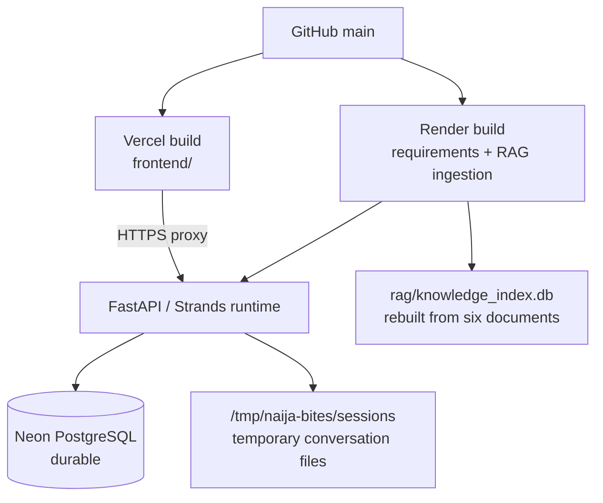

# Naija Bites — System Architecture

**Reference implementation:** `main` at `db7f62f` · **Purpose:** Project 2, Vendor Sales and Order AI Agent · **Status:** Educational demo, Paystack TEST only.

This document explains the architecture actually implemented, not the unmerged olive-green redesign. The requirements are in [../Use_case.md](../Use_case.md); setup, features and limitations are in [../README.md](../README.md).

## 1. Deployment and component diagram



### Ownership of responsibilities

| Component | What it owns | What it must **not** be trusted to do |
|---|---|---|
| Browser / Next.js | Customer input, chat display, review card, explicit approval action, test checkout redirect | Supply a trusted customer ID or invent an approved total |
| FastAPI | Authenticate requests, bind customer session, expose API, route agent and trusted actions | Treat an unauthenticated model message as authorization |
| Strands agent | Understand intent, call registered tools, compose friendly answers | Confirm checkout, alter database balances, mark a payment successful |
| Domain services | Validate cart, inventory, delivery, customization, discount, summary and order transaction | Accept prices or discounts solely because the model suggested them |
| PostgreSQL | Operational source of truth | Persist model conversation files (separate storage) |
| RAG index | Retrieve source-labelled policy/FAQ text | Override live prices, availability, payment or order state |
| Paystack TEST | Test checkout and transaction status | Authorize real-money transactions in this demo |

### Authentication / first-party proxy

```mermaid
sequenceDiagram
    participant C as Customer browser
    participant N as Next.js (Vercel)
    participant A as FastAPI (Render)
    participant DB as PostgreSQL
    C->>N: POST /api/backend/auth/login
    N->>A: Rewrite to /auth/login
    A->>DB: Verify Argon2 password; save hashed session token
    DB-->>A: Verified customer
    A-->>N: Set-Cookie: HttpOnly; Secure in demo; SameSite=Lax
    N-->>C: Authenticated response + first-party cookie
    C->>N: GET /api/backend/auth/me (cookie)
    N->>A: Forward request/cookie
    A->>DB: Validate token and expiry
    A-->>C: Current customer (through Next.js)
```

`agui_server.py` derives the trusted session ID from the authenticated customer, not from an agent-supplied argument. The frontend auth gate is a usability feature; the backend authorization check is the security boundary. An invalid/expired cookie must not authorize a checkout or another customer's order lookup.

## 2. Conversational order workflow

```mermaid
sequenceDiagram
    autonumber
    participant C as Customer
    participant UI as Next.js UI
    participant API as FastAPI
    participant AI as Strands + Bedrock
    participant S as Domain services
    participant DB as PostgreSQL
    C->>UI: Ask for a meal / delivery / discount
    UI->>API: POST /agent (AG-UI)
    API->>AI: Run agent in authenticated session
    AI->>S: Browse menu, check cart, get delivery areas, search policies
    S->>DB: Read current catalogue, stock, delivery and cart
    DB-->>S: Verified values
    S-->>AI: Structured tool results
    AI-->>UI: Stream conversational answer
    C->>UI: Select items and provide delivery details
    UI->>API: POST /agent
    API->>AI: Prepare checkout request
    AI->>S: create_order tool -> prepare_checkout ONLY
    S->>DB: Recalculate items, price, discount, delivery, stock
    S->>DB: Save pending summary + SHA-256 fingerprint
    AI-->>UI: Explain that review is required
    UI->>API: GET /checkout
    API->>DB: Read saved pending summary
    API-->>UI: Trusted summary + fingerprint
    UI-->>C: Display exact review card
    alt Customer explicitly approves
        C->>UI: Approve reviewed order
        UI->>API: POST /checkout/confirm
        API->>S: confirm_checkout(approved, fingerprint)
        S->>DB: Transaction: revalidate summary and inventory
        alt Same summary and sufficient stock
            S->>DB: Insert order/items, deduct stock, clear cart, COMMIT
            API-->>UI: Order ID + pending_payment
        else Changed details / insufficient stock
            S->>DB: ROLLBACK
            API-->>UI: Conflict; prepare a new review
        end
    else Customer does not approve
        Note over C,DB: No order is placed
    end
```

**Why the fingerprint matters:** `services/order_service.py` creates a SHA-256 fingerprint from a canonical JSON summary. The application compares the approved fingerprint with the saved summary and a freshly recalculated summary. This protects against accidental stale approval when the cart, fees, or stock change. It is not a substitute for authentication: the server also binds checkout to the signed-in customer.

**Why transactions matter:** The order and inventory changes occur together. A failure in availability checks or stock deduction triggers rollback, avoiding a partly saved order.

## 3. Test payment and status workflow

```mermaid
sequenceDiagram
    participant C as Customer
    participant UI as Next.js
    participant API as FastAPI
    participant DB as PostgreSQL
    participant PS as Paystack TEST
    C->>UI: Pay for confirmed checkout order
    UI->>API: POST /payments/initialize (order_id, email)
    API->>DB: Verify order belongs to session; status pending_payment
    API->>PS: Initialize test transaction (amount in kobo)
    PS-->>API: Test authorization_url + reference
    API->>DB: Save payment reference and link
    API-->>UI: Test checkout URL
    UI->>PS: Redirect customer to hosted TEST checkout
    PS-->>UI: Return to configured frontend callback
    UI->>API: POST /payments/verify (reference)
    API->>PS: Server-side verify transaction
    PS-->>API: Reference, amount, currency, provider status
    API->>DB: Check reference + amount + NGN match
    alt Provider confirms success
        API->>DB: Set payment paid; order confirmed
    else Not successful
        Note over API,DB: Do not claim payment succeeded
    end
    opt Signed webhook
        PS->>API: POST /payments/webhook + signature
        API->>API: Validate HMAC signature
        API->>PS: Verify reference server-side
        API->>DB: Idempotent payment/order update
    end
```

The Paystack code requires a secret beginning with `sk_test_`. Payment success is **never** inferred from the customer's statement, a browser redirect alone, or an LLM response. The separate `tools/payment.py` produces a `mock://` link but is **not registered** in the active agent; the browser flow uses the Paystack test API service.

## 4. Logical data model



Additional customer preference tables are managed in `memory/preferences.py`; the ER diagram focuses on the operational ordering domain. Order history and payment records live in PostgreSQL, while the Strands model's file-backed message history lives separately.

## 5. AI tool registration and source-of-truth boundaries

`agent.py` constructs the Strands agent **only for a verified customer session** and registers:

- `browse_menu`, `search_menu`, `list_delivery_areas` (defined in `agent.py`).
- `search_knowledge_base` (from `rag/tool.py`).
- Session-bound cart tools: `get_customization_options`, `add_to_cart`, `view_cart`, `set_cart_line_quantity`, `clear_cart`.
- Session-bound order tools: `create_order` (**prepare only**), `get_order_status`.
- Preference tools: `get_customer_preferences`, `remember_food_preference`, `forget_food_preference`.

Standalone modules `tools/catalogue.py`, `tools/inventory.py`, `tools/delivery.py`, `tools/discount.py`, `tools/payment.py`, and `tools/notifications.py` implement assignment-style tools but **are not added to the current `make_agent` list**. Some of their behavior is achieved by other registered tools or trusted services. Owner notification is **not currently reachable by the active agent**.

### Decision authority matrix

| Question | Source of truth |
|---|---|
| What is on the menu and how much does it cost? | `products` + `inventory` via repository |
| Is this variant / customization available? | Inventory and customization service |
| What delivery areas, fees and estimates apply? | `delivery_zones` |
| What discount is allowed? | `config.py` + deterministic order/discount service |
| What is the exact order total? | Server-calculated checkout summary |
| Has the customer approved the order? | Trusted UI approval + backend confirmation |
| Has payment succeeded? | Paystack server-side verification + stored payment record |
| What does the return policy say? | RAG-retrieved policy document (with source) |
| Which customer's order can be viewed? | Authenticated session ownership checks |

## 6. Deployment and data lifecycle



In `NAIJA_BITES_ENV=demo`, backend startup requires a valid `DATABASE_URL`, HTTPS frontend origin, Paystack test key, matching callback URL and Bedrock model ID. It creates missing schema and sample menu without resetting existing orders/stock. PostgreSQL solves the former **ephemeral operational database** problem, but does not make file-backed Strands history durable.

The `DEPLOY_DEMO.md` guide includes earlier SQLite-era wording; `POSTGRES_SETUP.md` and current code explain the newer PostgreSQL arrangement.

## 7. Security controls and limitations

**Implemented design controls:**

- Argon2 password hashing; hashed auth-session tokens; seven-day sessions; HttpOnly cookie, Secure in demo, SameSite=Lax.
- Server-derived customer session and order ownership checks.
- Origin checks for POST requests, with a separate signature-verified Paystack webhook.
- Tool/service-based catalogue, stock and pricing; explicit confirmation before order creation.
- Fresh summary/stock validation and atomic stock deduction.
- Paystack test-key restriction and server-side amount/reference/currency verification.
- RAG text treated as informational evidence, not instructions or transactional authority.

**Not production-ready:**

- No durable hosted Strands conversation history on temporary Render storage.
- No real owner notification delivery, owner dashboard, dispatch integration or voice feature.
- Optional observability modules exist, but their activation should not be assumed merely from their presence.
- No demonstrated full production security review, backup strategy or abuse-rate protection.
- Some standalone assignment tool wrappers are not connected to the live agent.
- Policy statements about expiry, refund approval and special offers may describe **proposed** processes rather than automated actions.
- Documentation inspection is not equivalent to running every unit test or all seven assignment scenarios end-to-end.

## 8. Assignment presentation summary

> **Naija Bites uses an AI agent for conversation, RAG for policy knowledge, and tools for live business data. The model can prepare a checkout, but it cannot place an order or confirm payment by itself. Customer approval, pricing, inventory changes and Paystack verification are enforced by the backend. PostgreSQL stores operational records, while model conversation history remains file-backed.**

This distinction between **AI assistance** and **application authority** is the core architectural idea to communicate during the assignment demonstration.
